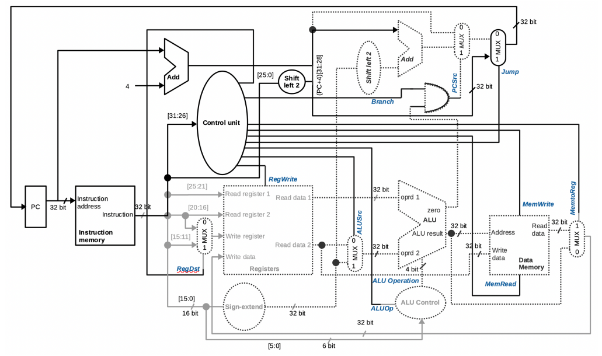

# SystemVerilog MIPS CPUs

Two educational 32-bit MIPS-subset processors implemented in SystemVerilog:

- **[Single-cycle CPU](single_clock_cycle/README.md):** executes one instruction per clock cycle.
- **[Five-stage pipelined CPU](pipelined/README.md):** overlaps instruction execution across IF, ID, EX, MEM, and WB, with forwarding and hazard handling.

Both designs include self-checking testbenches, sequential reference models, reproducible randomized tests, and Python test runners. They share an instruction subset, but have separate RTL and simulation flows.

## Architecture comparison

| Property | Single-cycle | Pipelined |
| --- | --- | --- |
| Top-level module | `datapath_single_cycle` | `five_stage_pipelined` |
| Execution | One instruction per cycle | Five overlapping stages |
| Pipeline registers | None | IF/ID, ID/EX, EX/MEM, MEM/WB |
| Data dependencies | Resolved by normal register reads on the next cycle | EX/MEM and MEM/WB forwarding, plus WB-to-ID bypass |
| Load-use dependency | No extra cycle | One stall for an immediate consumer |
| Branch resolution | Within the instruction's cycle | MEM stage; younger instructions are flushed when taken |
| Jump resolution | Within the instruction's cycle | ID stage |
| Delay slots | None | None |
| Reset | Synchronous, active high | Synchronous, active high |

A single-cycle clock must accommodate the complete instruction path. Pipeline throughput depends on stalls and redirects; this repository does not claim a measured clock frequency or FPGA performance result.

## Supported instructions

| Group | Instructions |
| --- | --- |
| Register arithmetic and logic | `add`, `sub`, `and`, `or`, `slt` |
| Immediate arithmetic and logic | `addi`, `andi`, `ori`, `slti` |
| Word memory access | `lw`, `sw` |
| Control flow | `beq`, `j` |
| No operation | `nop` (`0x00000000`) |

`andi` and `ori` zero-extend the immediate; the other supported immediate operations use sign extension. `slt` and `slti` perform signed comparisons. Register `$0` always reads as zero.

These are teaching implementations, **not complete MIPS ISA implementations**. They have no delay slots, exceptions, overflow traps, interrupts, caches, byte/halfword accesses, `jal`, `jr`, multiply/divide, or HI/LO registers. Arithmetic wraps modulo 2^32. Unsupported opcodes/functions have no architectural side effects rather than raising an exception.

## Quick start

Requirements: Python 3 and Icarus Verilog (`iverilog` and `vvp`) on your PATH. GTKWave is optional for waveform viewing. No third-party Python packages are needed.

From an Ubuntu or WSL terminal:

```bash
git clone https://github.com/khoatruong2805/systemverilog-mips-cpu.git
cd systemverilog-mips-cpu
python3 single_clock_cycle/run_tests.py
python3 pipelined/run_tests.py
```

Each runner selects its own simulation working directory, compiles its design, runs the testbenches, and checks the results. Generated binaries and logs are placed in that design's `build/` directory. A compilation error, unexpected simulation result, or timeout returns a nonzero exit status.

**Compile the two designs separately.** They intentionally contain modules with the same names, such as `alu`, `register`, and `main_control`; compiling both source trees into one library can cause duplicate-module conflicts.

## Verification

| Suite | Verified result |
| --- | --- |
| Single-cycle original demo | 10 checks passed |
| Single-cycle regression | 35 cases, 197,694 checks, 1,957 instruction cycles passed |
| Single-cycle jump unit | 3 checks passed |
| Single-cycle invalid-access tests | 7 expected failures correctly detected |
| Pipelined demo | Passed |
| Pipelined regression | 41 cases, 14,357 checks passed |
| Pipelined invalid-access tests | 5 expected failures correctly detected |

Each regression includes 20 deterministic randomized programs. The single-cycle reference model checks control signals, PC, registers, and RAM after each instruction. The pipeline reference model checks the order, destination, and value of architectural writes; additional monitors check stalls, bubbles, flushes, and redirect priority.

The invalid-access tests deliberately trigger `$fatal`. Their runners require both a failing exit status and the expected diagnostic. These messages are expected when the final summary says `ALL SUITES PASS`.

Passing these tests is evidence for the documented instruction subset, not an exhaustive proof or post-synthesis timing verification.

## Memory and reset model

- Separate instruction and data memories, each containing 64 words (256 bytes).
- Byte addresses with word-aligned accesses.
- Combinational instruction, register-file, and data-memory reads; clocked writes.
- Reset clears the PC and register file, and also clears pipeline registers in the pipelined design. RAM contents are preserved and architectural writes are suppressed during reset.
- Instruction memory is initialized to NOPs before loading the program. RAM has no default initialization; programs must store before loading, or testbenches must prepare memory explicitly.
- Simulation-only diagnostics do not implement hardware exceptions. Replacing combinational reads with synchronous FPGA block RAM requires timing and control changes.

## Repository layout

```text
systemverilog-mips-cpu/
├── README.md
├── LICENSE
├── image.png                  # Single-cycle datapath reference
├── single_clock_cycle/
│   ├── README.md
│   ├── src/                   # Single-cycle RTL
│   ├── tb/                    # Testbenches and machine_code.txt
│   └── run_tests.py
└── pipelined/
    ├── README.md
    ├── src/                   # Five-stage RTL
    ├── tb/                    # Testbenches
    ├── program.txt
    └── run_tests.py
```

Simulation binaries, waveforms, logs, and build directories are generated locally and excluded from version control.

## Single-cycle datapath reference



This image illustrates the single-cycle datapath, not the five-stage pipeline. The RTL also includes reset handling and logical-immediate zero extension that are not detailed in the illustration. See the project-specific READMEs for implementation behavior and waveform commands.

## License

See [LICENSE](LICENSE) for the repository's license terms.
